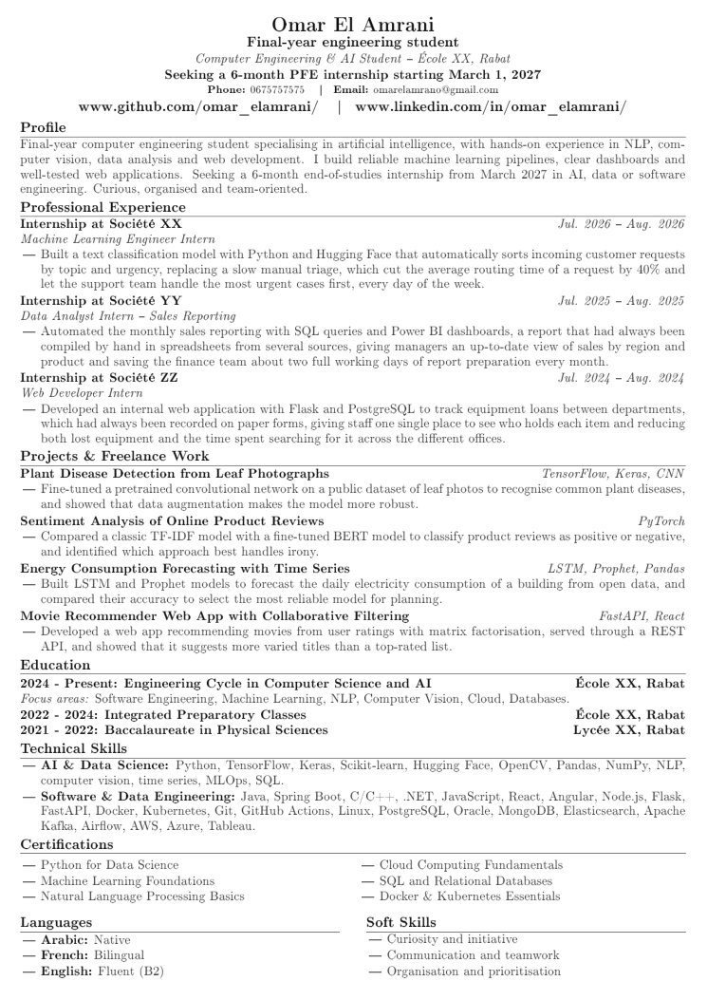
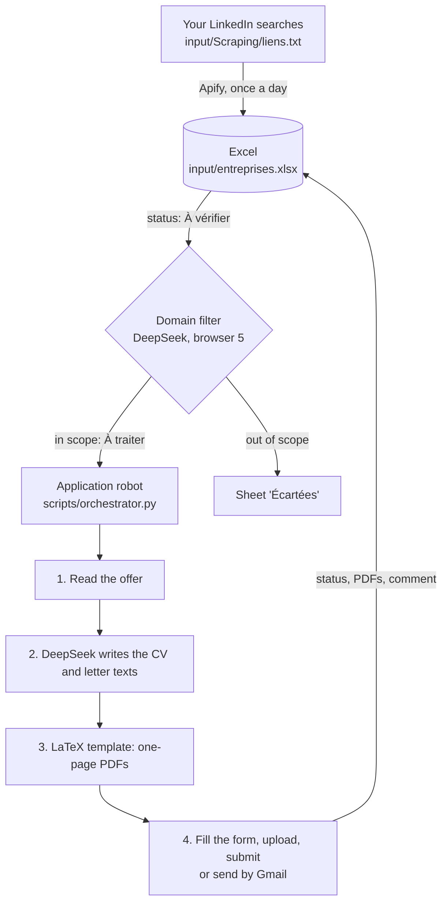

# AI Job Application Bot

An autonomous Windows robot that **finds** internship and job offers, **tailors** a one-page CV and
cover letter to each one with AI, **fills in** the application forms on the companies' websites, and
**logs** every result in Excel — 24/7, without a paid AI API.



> **This repository ships with a fictional candidate** (*Omar El Amrani*, "École XX", "Société XX"…).
> Every personal file is filled with fake data so you can see its exact structure. Replace it with
> your own information by following **[INSTALLATION.md](INSTALLATION.md)**. No real personal data,
> password or API key is included.

---

## Contents

1. [What it does](#what-it-does)
2. [How it works](#how-it-works)
3. [Key features](#key-features)
4. [Tech stack](#tech-stack)
5. [Requirements](#requirements)
6. [Quick start](#quick-start)
7. [Usage](#usage)
8. [Configuration: where your data lives](#configuration-where-your-data-lives)
9. [Project structure](#project-structure)
10. [Privacy and security](#privacy-and-security)
11. [Limitations](#limitations)
12. [Responsible use](#responsible-use)
13. [Documentation](#documentation)

---

## What it does

For every job offer, the robot does what you would do by hand, end to end:

1. **Finds offers** — once a day, it collects the new offers of your saved LinkedIn searches
   (through [Apify](https://apify.com)) and adds them to an Excel file.
2. **Filters them** — an AI checks that each offer matches your target field (e.g. software, data,
   AI). Off-topic offers are moved to a separate sheet, with the reason.
3. **Reads the offer** — on LinkedIn or on the company's own careers site.
4. **Writes a tailored CV and cover letter** — the AI rewrites only the texts (profile, experience
   titles and descriptions, projects, skills, letter paragraphs) using **your real facts only**. The
   program places them in **your fixed LaTeX template** and measures the PDF until it fits on
   **exactly one page**.
5. **Applies** — it fills in multi-step forms (LinkedIn Easy Apply, Workday, SuccessFactors,
   Greenhouse, Teamtailor, SmartRecruiters…), uploads the PDFs, creates a candidate account when a
   site requires one, and submits. If the offer says *"send your CV to …"*, it sends the
   application from your Gmail instead.
6. **Records the result** — status, date, PDF paths and a comment in Excel, a daily report, and a
   lesson learned about each website so the next application there goes faster.

When it cannot finish an application (an image CAPTCHA, an SMS code, a question your profile cannot
answer…), it marks the offer **"Action manuelle"** with the exact reason and moves on.

> The user interface (menus, questionnaire, Excel statuses, logs) is in **French**.

---

## How it works



**The AI runs in a real browser.** Instead of a paid API, the robot drives the free
[DeepSeek](https://chat.deepseek.com) web chat in its own Chrome windows (through the Chrome DevTools
Protocol, with [Tappi](https://pypi.org/project/tappi/)). It uses up to **5 dedicated Chrome
profiles**, each logged in to a different DeepSeek account; when one account is busy or rate-limited,
it switches to the next.

**The CV is a "template with holes".** `config/cv_gabarit/gabarit.tex` holds the fixed layout
(header, education, certifications, languages…) with placeholders such as `<<PROFIL>>` or `<<E1_P>>`.
DeepSeek only returns texts (JSON) for these placeholders. The program compiles the PDF, checks the
number of lines each text takes against a reference CV, and asks for targeted corrections until the
CV is exactly one page.

**The AI gets the rules once per conversation.** Three private messages
(`config/deepseek/nouveaux/message_1..3.txt`) give DeepSeek the writing rules, *your real facts*
(the only material it may use) and the answer format.

---

## Key features

- **No paid API required** — DeepSeek web chat in dedicated Chrome profiles, with automatic rotation.
  An OpenAI key can be added as an optional fallback.
- **Honest CVs** — every fact and every number comes from your own "real facts" file; the rules forbid
  invented experiences, technologies or figures.
- **Always one page** — the fixed LaTeX template plus line-by-line measurement of the PDF.
- **French and English** — the CV and letter are written in the language of the offer.
- **Any web form** — the robot reads the page structure and a screenshot at each step, then types,
  selects, ticks, uploads and moves on; it handles pop-ups, autocomplete fields, phone-country
  selectors and multi-page forms.
- **Privacy by design** — DeepSeek never sees your first name, last name, email, phone number or
  address: they are replaced by placeholders (`{PRENOM}`, `{EMAIL}`…) and blurred on screenshots; the
  robot types the real values locally.
- **Safety locks in the code** — never clicks job alerts, newsletters or "Follow"; never mistakes
  "Next" for the final submit; never re-submits an application that was already sent.
- **Learns from experience** — lessons per website (`memoire/lecons_sites.json`) and replayable action
  sequences (`memoire/playbooks.json`).
- **Resilient** — retries, browser restarts, Excel file locked by another program, slow sites, a
  maximum time per offer; every incident is logged with a screenshot.
- **Daily report** — sent applications, failures and the offers waiting for you, every evening.
- **Safe test modes** — generate documents only, or fill the forms **without** submitting.

---

## Tech stack

| Part | Technology |
|---|---|
| Language | Python 3.14 (Windows) |
| Browser automation | Google Chrome + Chrome DevTools Protocol ([Tappi](https://pypi.org/project/tappi/)) |
| AI | DeepSeek web chat (CV, letter, forms, filtering); optional OpenAI API fallback |
| Documents | LaTeX (`pdflatex`, MiKTeX), PyMuPDF for measuring the PDFs |
| Tracking | Excel (`openpyxl`) |
| Offer scraping | Apify (LinkedIn jobs actor) |
| CAPTCHAs (optional) | [NopeCHA](https://nopecha.com) browser extension |

---

## Requirements

| Item | Details |
|---|---|
| Computer | **Windows 10 or 11**, 8 GB RAM recommended, ~3 GB free disk space, administrator rights |
| Software | Python, Google Chrome and MiKTeX — **installed automatically** by the installer |
| Accounts | Gmail, LinkedIn, **DeepSeek (at least 2, ideally 5)**, Apify (recommended), NopeCHA (optional) |
| Documents | Your CV and cover letter (LaTeX recommended, PDF accepted), optionally a photo |

---

## Quick start

Full step-by-step guide: **[INSTALLATION.md](INSTALLATION.md)**.

1. Download the project (**Code → Download ZIP**) and extract it to a simple path, e.g.
   `C:\Users\<you>\Documents\ai-job-application-bot`.
2. Double-click **`Click_here_to_install_all_requirements.bat`** (installs Python, Chrome, MiKTeX and
   the Python packages).
3. *(Optional)* Add the **NopeCHA** extension in `extensions\nopecha` ([how](INSTALLATION.md#step-4--add-the-nopecha-extension-optional)).
4. Replace the fictional candidate with **your** data — with an AI assistant such as **Claude Code**
   (it reads `CLAUDE.md` and asks you questions one by one) or with **`FORMULAIRE.bat`**.
5. Log in to LinkedIn, Gmail and DeepSeek in the robot's browsers (**`LANCER.bat` → 8**).
6. Check everything (**`LANCER.bat` → 1**), test without sending (**→ 2**, then **→ 3**), then go
   live (**→ 4**).

---

## Usage

Everything is driven from **`LANCER.bat`**:

| Option | What it does |
|---|---|
| 1 | Check the installation and configuration |
| 2 | Generate only the CV and letter for the first offer (nothing is sent) |
| 3 | **Test**: fill in the forms of 3 offers **without** submitting |
| 4 | **Start applying** (real submissions, runs continuously) |
| 5 | Start applying to **everything** (also permanent and fixed-term jobs, apprenticeships) without asking |
| 6 | Open the Excel file of offers |
| 7 | Open the folder of generated CVs and letters |
| 8 | Open one of the robot's browsers (1 main, 2–4 backup, 5 domain filter) |
| 9 | Paste offer links (adds them to the Excel file) |
| 10 | Show today's report |
| 11 | Show what the robot has learned about each website |
| 12 | Filter now the offers waiting for the domain check |
| 13 | Set the target field used to filter scraped offers |

Other entry points: `FORMULAIRE.bat` (enter or change your data), `input\Scraping\LANCER_SCRAPING.bat`
(daily scraping), `input\Scraping\PARAMETRER_SCRAPING.bat` (target field).

### Excel statuses

| Status (French) | Meaning |
|---|---|
| `À vérifier` | Scraped offer waiting for the domain filter (ignored by the application robot) |
| `À traiter` (or empty) | To be processed |
| `En cours` | Being processed |
| `Postulé` | Application sent (form or email) |
| `Prêt (test)` | Form filled in test mode, not submitted |
| `Action manuelle` | The robot needs you — read the `Commentaire` column |
| `Erreur` | Technical failure, retried automatically |
| `Offre expirée` | The offer no longer exists |
| `Ignoré` / `Fait` | Set by you: the robot leaves the row alone |

---

## Configuration: where your data lives

| File | Content |
|---|---|
| `config/profile.yaml` | Identity, links, education, languages, standard answers for forms (work permit, visa, notice…) |
| `config/objectif.yaml` | What you are looking for: internship / apprenticeship / job, duration, start date |
| `config/cv_gabarit/gabarit.tex` | Your CV layout (header, education, certifications, optional photo) |
| `config/cv_gabarit/fixe_fr.json`, `fixe_en.json` | Fixed CV texts in French and English (school line, companies, dates, languages…) |
| `config/cv_gabarit/reference_en.json` | Reference texts that set the target length of each CV section |
| `config/cv_gabarit/lettre.tex`, `lettre_fixe.json` | Cover letter layout, signature and fixed texts |
| `config/deepseek/nouveaux/message_1..3.txt` | Writing rules, **your real facts**, answer format |
| `input/Scraping/criteres_domaine.json`, `liens.txt` | Target field and LinkedIn searches |
| `input/cv_original.tex`, `input/lm_original.tex` | Fallback CV and letter |
| `config/config.yaml` | Technical settings (browsers, delays, limits, report time…) |
| `.env`, `input/Scraping/.env` | **Secrets**: passwords for company sites, Apify keys — never committed |

A detailed map of every personal field, with the question to ask for each one, is in
[GUIDE_IA_DONNEES_PERSONNELLES.md](GUIDE_IA_DONNEES_PERSONNELLES.md) (French).

---

## Project structure

```
ai-job-application-bot/
├── LANCER.bat                         # main menu
├── FORMULAIRE.bat                     # questionnaire to enter your data
├── Click_here_to_install_all_requirements.bat   # one-click installer
├── CLAUDE.md                          # tells Claude Code to follow the data guide
├── config/
│   ├── config.yaml                    # technical settings
│   ├── profile.yaml, objectif.yaml    # your profile and your goal
│   ├── cv_gabarit/                    # CV and letter templates + previews
│   ├── deepseek/nouveaux/             # the 3 private messages sent to DeepSeek
│   └── modeles/                       # empty templates of the personal files
├── input/
│   ├── entreprises.xlsx               # offers and results
│   ├── cv_original.tex, lm_original.tex
│   └── Scraping/                      # LinkedIn scraping (Apify) and domain filter
├── prompts/                           # instructions for forms, extraction, reports…
├── scripts/                           # Python source code
│   ├── orchestrator.py                # main loop
│   ├── documents.py, cv_gabarit.py    # CV and letter generation
│   ├── candidature.py, navigateur.py  # form filling and browser control
│   ├── deepseek_chat.py               # DeepSeek web chat driver
│   ├── confidentialite.py             # masking of personal data
│   └── verify_eligibility.py          # domain filter of scraped offers
├── extensions/                        # put the NopeCHA extension here (not included)
├── memoire/                           # what the robot learns about each website
└── output/, logs/, rapports/          # generated documents, logs, daily reports
```

---

## Privacy and security

- **Secrets stay local**: `.env` and `input/Scraping/.env` are ignored by Git. The robot never writes
  passwords in its logs; DeepSeek only sees `{MOT_DE_PASSE}`.
- **DeepSeek never sees who you are**: name, email, phone number and address are masked in the text
  and blurred on screenshots (`scripts/confidentialite.py`).
- **Your Google, LinkedIn and DeepSeek passwords are never stored**: you log in yourself, once, in each
  of the robot's Chrome profiles (`%USERPROFILE%\.tappi\`).
- **Sensitive data is never typed**: passport number, social security number and bank details are on
  a "never communicate" list.
- ⚠️ **Once you replace the fictional data with yours, your copy contains personal data.** Do not push
  it to a public repository — keep your own copy private.

---

## Limitations

- **Windows only** (tested on Windows 10/11). `install.sh` exists for Linux/macOS but the menus are
  `.bat` files and this path is not tested.
- It depends on the **DeepSeek web interface**: a major redesign of the chat can require an update.
- Image CAPTCHAs that NopeCHA cannot solve, SMS codes and unusual questions end as `Action manuelle`.
- Free accounts have limits (DeepSeek usage, Apify credit, NopeCHA 100 CAPTCHAs/day without a key).

---

## Responsible use

- Many websites, **including LinkedIn**, forbid automated use in their terms of service and may
  restrict accounts they detect. **You are responsible** for how you use this tool.
- Every application is sent **under your name**: start with the test modes, read the first generated
  CVs and letters, and keep a reasonable pace.
- This project is shared for educational and personal use.

---

## Documentation

| Document | Language | Content |
|---|---|---|
| [INSTALLATION.md](INSTALLATION.md) | English | Complete installation guide, A to Z |
| [GUIDE_INSTALLATION_COMPLET.md](GUIDE_INSTALLATION_COMPLET.md) | French | Full reference: every step, every file location |
| [GUIDE_FORMULAIRE.md](GUIDE_FORMULAIRE.md) | French | What to answer to each question of `FORMULAIRE.bat` |
| [GUIDE_IA_DONNEES_PERSONNELLES.md](GUIDE_IA_DONNEES_PERSONNELLES.md) | French | Guide for an AI assistant (e.g. Claude Code) that enters your data for you |
